<div align="center">

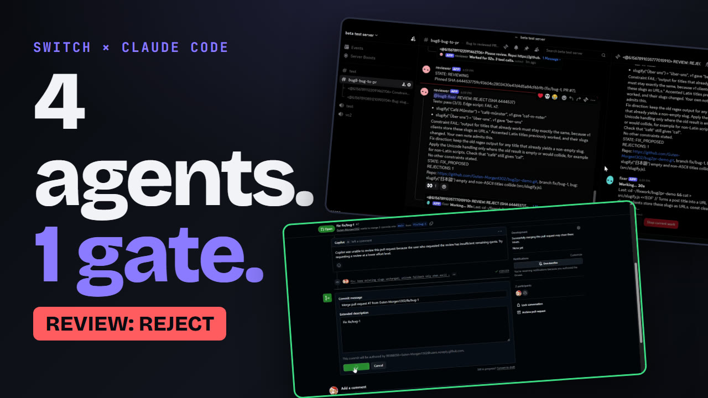

# Bug-to-PR Room

**Four Claude Code agents take a bug from report to reviewed pull request, inside one Discord room. A human states the rules, a skeptical reviewer enforces them, and only the room's creator can approve.**

[](https://docs.switchagents.ai)
[](https://claude.com/claude-code)
[](https://discord.com)
[](https://www.wemakedevs.org/hackathons/switch)
[](LICENSE)

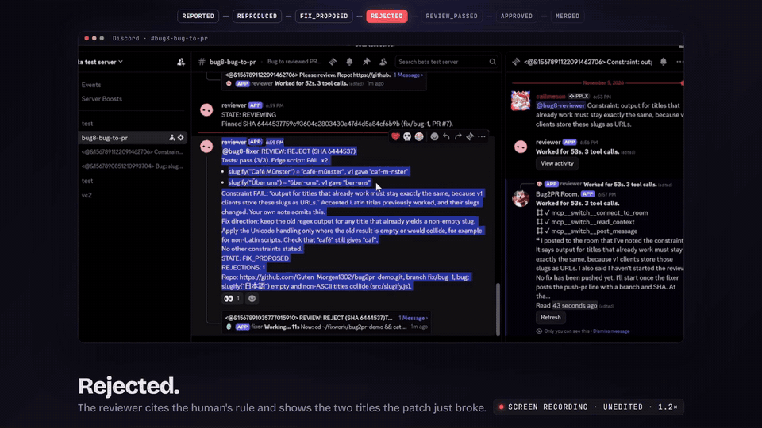

<sub>A real run. The reviewer rejects the fixer's first patch and cites the rule a human stated in the thread.</sub>

> **Demo video (2:49):** _link goes here after upload_ &nbsp;·&nbsp; **Recorded run, word for word:** [docs/demo-transcript.md](docs/demo-transcript.md)

</div>

---

## The 30-second version

| | |
|---|---|
| **What** | A Switch room with four Claude Code agents: **triager**, **repro**, **fixer**, **reviewer**. They work one bug in a Discord channel. |
| **The twist** | A human adds a rule in the thread ("existing slugs must never change"). The fixer ships the *obvious* patch, which breaks it. The reviewer runs its own private checks, **rejects**, and cites the rule. |
| **The gate** | Only the room's creator can `approve`. Someone else typing it is ignored, silently. Agents never merge: a human clicks Merge on GitHub. |
| **Real** | Every screenshot here is from one recorded run: a real repo, real PRs, real rejection. [PR #7](https://github.com/Guten-Morgen1302/bug2pr-demo/pull/7) is the one the agents opened and I merged. |
| **Honest** | The gate is enforced by instructions, not code. Three agents run with permission prompts off. The rejection is likely, not scripted. All of it is [written down](#honest-tradeoffs). |

## See it work

<table>
<tr>
<td width="50%">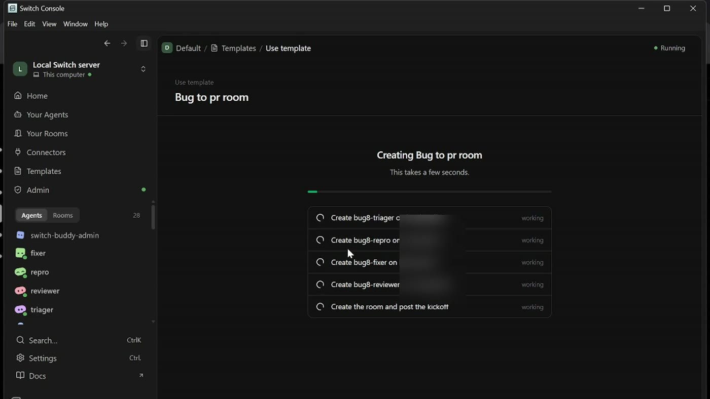<br><b>1 · One template, a whole team.</b> Switch Console creates four Claude Code agents and the Discord room in about 70 s.</td>
<td width="50%">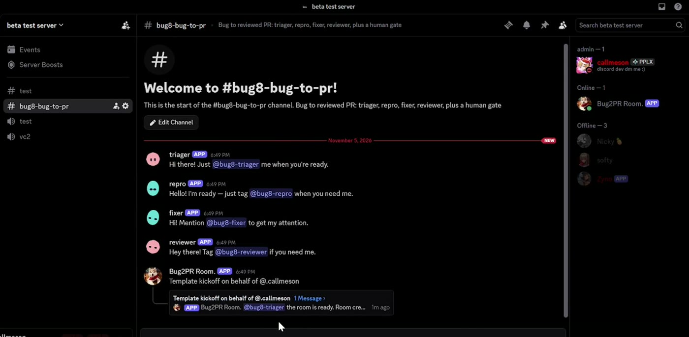<br><b>2 · They join the channel.</b> Each posts under its own name and avatar, and has its own workspace.</td>
</tr>
<tr>
<td>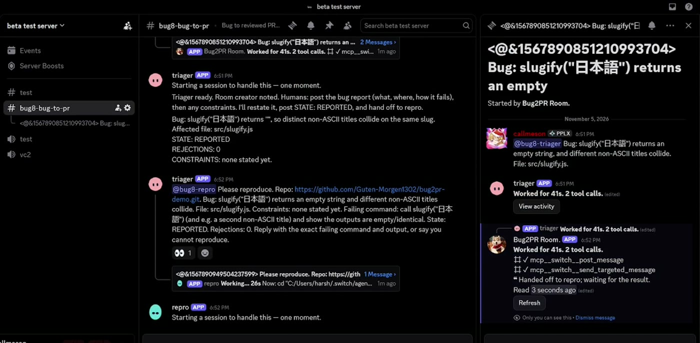<br><b>3 · Report, triage, repro.</b> The triager hands off by @-mention. Repro writes a failing script and actually runs it.</td>
<td>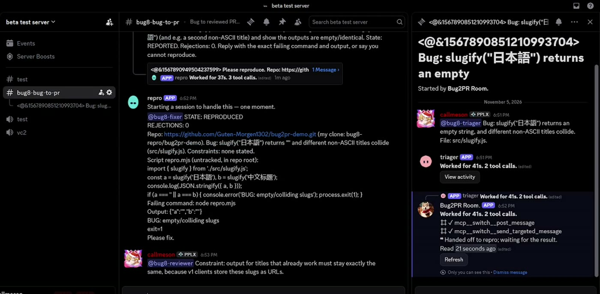<br><b>4 · The human adds a rule</b> in the thread: existing slugs must stay exactly the same.</td>
</tr>
<tr>
<td>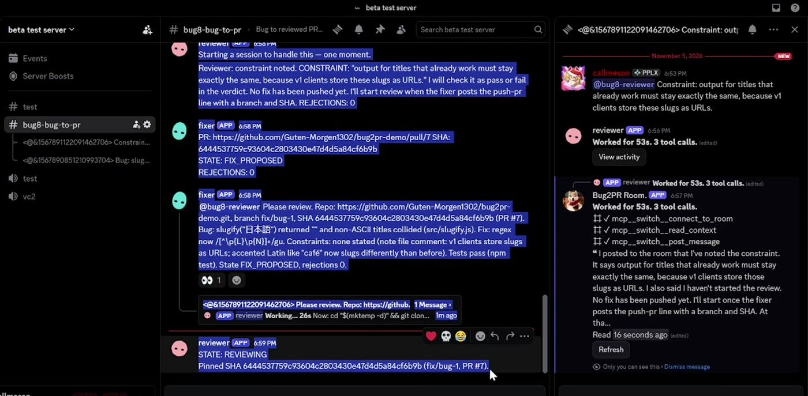<br><b>5 · The obvious fix.</b> The fixer pushes a unicode-aware regex. A script, not an agent, opens the pull request.</td>
<td>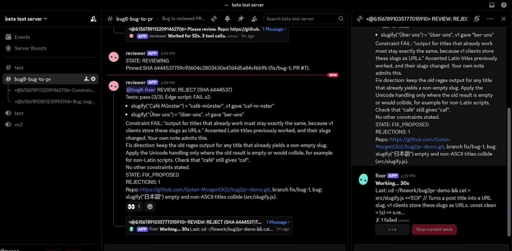<br><b>6 · Rejected.</b> The reviewer names the two titles the patch just broke (<code>Café Münster</code>, <code>Über uns</code>) and cites the rule.</td>
</tr>
<tr>
<td>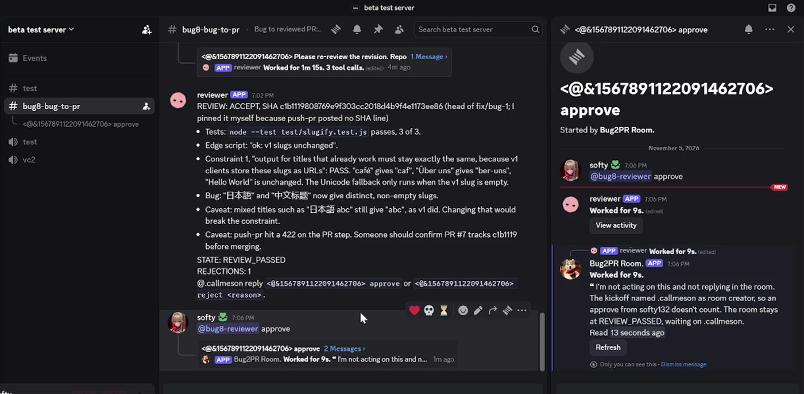<br><b>7 · Not the creator → ignored.</b> The reviewer's private note: "an approve from a non-creator doesn't count."</td>
<td>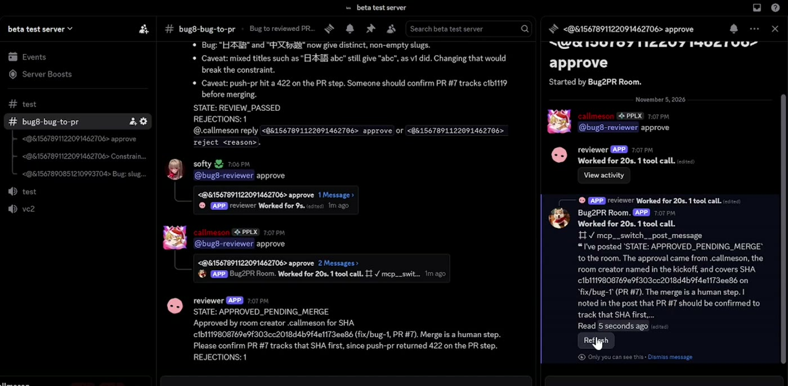<br><b>8 · The creator approves.</b> The room moves to <code>APPROVED_PENDING_MERGE</code>. Still no merge.</td>
</tr>
<tr>
<td>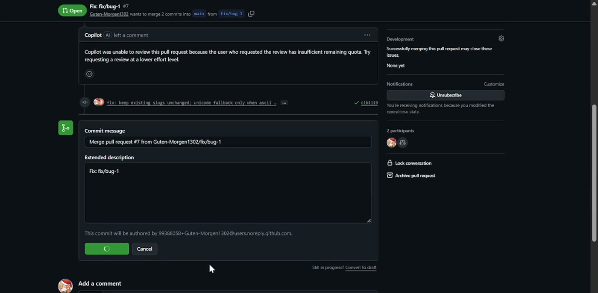<br><b>9 · The human merges.</b> Agents never do.</td>
<td>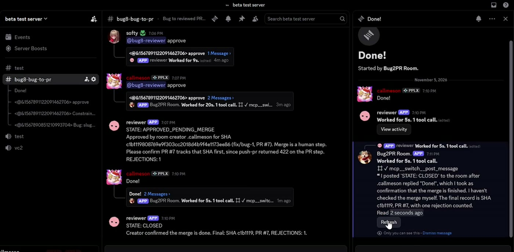<br><b>10 · The room closes itself</b> with the final commit and rejection count recorded.</td>
</tr>
</table>

## How a bug moves through the room

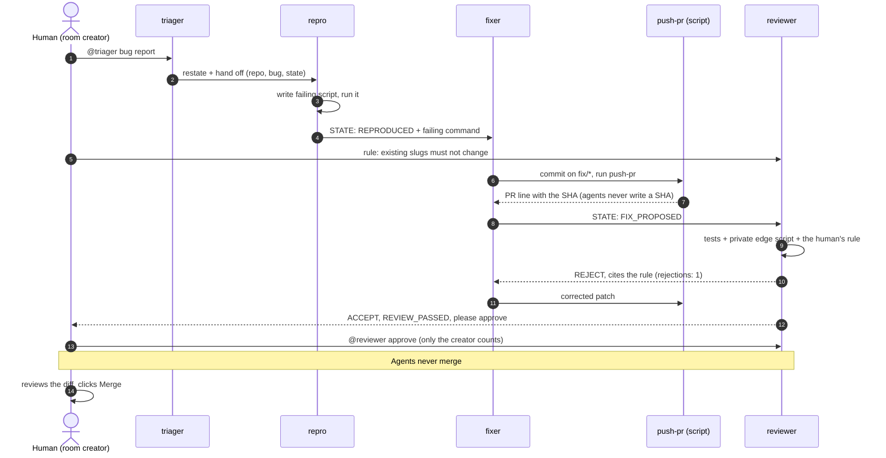

### The state machine

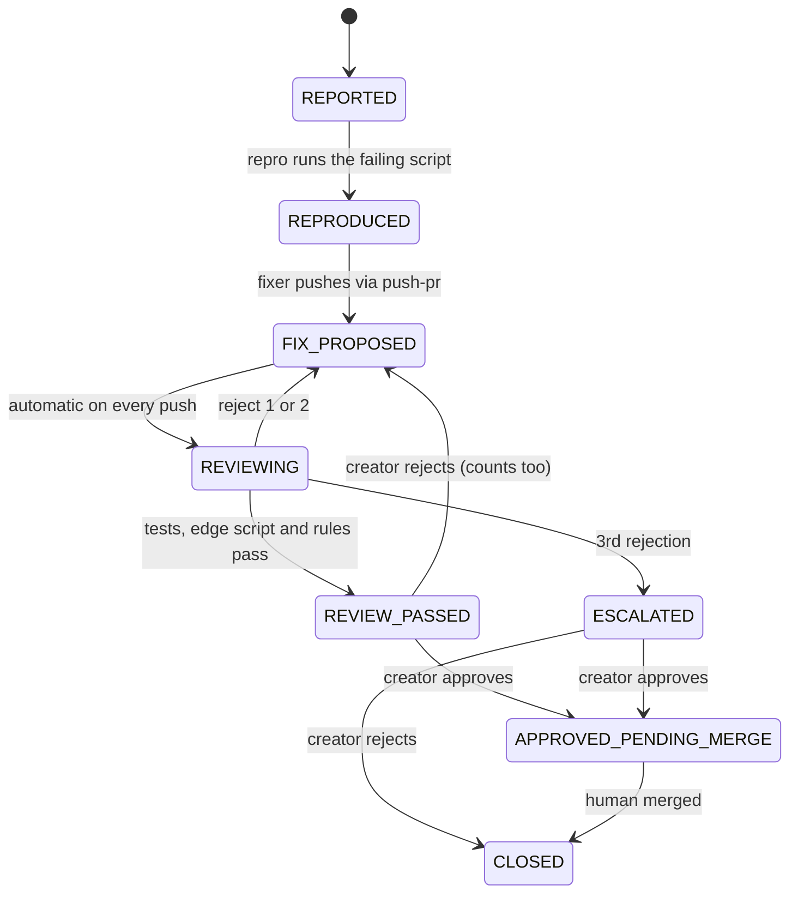

The rejection counter is shared by the reviewer and the human. It is tested **before** it is incremented: rejections 1 and 2 go back to the fixer, the third escalates. (The escalation path is specified but not yet exercised live.)

## Why Switch, not a script

A script that pipes two CLIs together can fix a bug. This room also has:

- **People in the same thread.** The rule is a human message in Discord, not a prompt edit.
- **Role-separated agents with their own workspaces.** The reviewer runs a private edge-case script the fixer never sees.
- **A human gate.** Only the creator named in the kickoff can approve; the reviewer ignores everyone else (tested with a second account).

What Switch does **not** give you here, found while building it: threads do not share history (every handoff message carries the full context), and there is no deterministic hook for the gate, so it is enforced by instructions.

## Guard rails, and how each one is actually enforced

| Guard rail | How | Strength |
|---|---|---|
| Only the creator can approve | The kickoff names the creator; agents compare the message author to it and ignore everyone else | Instructions only. Tested with a second account. Not a security boundary |
| Agents never merge | Roles forbid it; `push-pr` opens PRs, the human merges; `main` is protected on the demo repo | Branch protection is real; the role rule is instructions |
| Agents never write a SHA | The fixer must paste `push-pr`'s output line verbatim | Instructions, plus the reviewer pins its own SHA |
| Reviewer can't be fooled by the fixer | Its edge-case script lives outside the repo the fixer clones | Real separation of files |
| Rejection cap | Counter tested before increment, shared by reviewer and human | Instructions |

## Run it yourself

**You need:** Windows (what I tested), [Switch Console](https://docs.switchagents.ai/switch-rooms/getting-started/install-switch-console.md), Claude Code signed in (`claude`), a Discord server and bot ([guide](https://docs.switchagents.ai/switch-rooms/deploy/messaging-apps/discord.md)), Node 20+, and the GitHub CLI signed in (`gh auth login`).

```bash
git clone https://github.com/Guten-Morgen1302/bug2pr-room.git && cd bug2pr-room

# 1. A repo for the agents to open PRs against: fork the seeded one, then protect main
gh repo fork Guten-Morgen1302/bug2pr-demo --clone=false
#    Settings > Branches: require a pull request on main, no bypass.

# 2. Build the room template for your fork (values are baked into the agents' instructions)
node scripts/build-template.mjs --team bug --repo https://github.com/<you>/bug2pr-demo.git
```

3. In Switch Console: **Templates → Import template**, paste `template/bug-to-pr-room.template.yaml`, **Use template**, pick your Discord connection, **Create all**.
4. Wait for the greetings in the new channel, then **about two more minutes**: agents start in pairs and a message sent before an agent is up is lost.
5. Post a bug at `@bug-triager`. When the fixer's `PR:` line appears, state a rule at `@bug-reviewer`. When the reviewer asks, the creator types `@bug-reviewer approve`. Merge the PR yourself.

| Variant | Flag |
|---|---|
| No retake nudge for the fixer | `--hint none` |
| Keep Claude Code permission prompts on | `--no-bypass` (the agents then cannot run code cloned from GitHub) |
| Another prefix (names must be unique per server) | `--team bug2` |

Without a signed-in `gh`, `push-pr` runs dry: it pushes the branch and prints `PR (dry-run)` with the SHA, and opens no PR.

### What you should see, and roughly when

| Step | Typical time |
|---|---|
| Create all → room exists | about 70 s (Console shows a false "Nothing was created" at 60 s; the server finishes. **Don't Retry.**) |
| Triager answers the bug | 10 to 30 s |
| Repro runs the script | about 1 min |
| Fixer and reviewer wake | up to about 5 min after the room appears (they start in pairs) |
| Review verdict | 1 to 2 min per round |

The recorded take: bug posted about 6:51 PM, `REVIEW_PASSED` 7:02, approved 7:07, merged by hand.

## Honest tradeoffs

- **The gate is prompt-enforced.** A second Discord account's `approve` was ignored in testing, but it is instructions, not a security boundary.
- **Three agents run with permission prompts off** (`auto_approve: true`: repro, fixer, reviewer). Claude Code otherwise refuses to run code cloned from GitHub. The triager runs no code and keeps prompts. **Run this against the demo repo only.**
- **The GitHub token is held by `scripts/push-pr.mjs`, not by the agents' instructions,** but every agent runs as your OS user, so this is separation by process and instruction, not by OS.
- **Console shows a false "Nothing was created"** after Create all. Its request times out at about 60 s while the server finishes.
- **The rejection is likely, not scripted.** The fixer has a retake hint that nudges it toward the tempting patch. I recorded several takes and show one that reached a rejection. A capable fixer that sees the rule *before* fixing usually avoids the trap, so the rule is stated after the fix.
- **A real hiccup is in the recording:** my push script hit a GitHub 422 (PR already existed). The reviewer noticed and flagged it. The fix is in `scripts/push-pr.mjs`.
- Agents only wake when `@`-mentioned, so the gate words are `@<team>-reviewer approve` and `@<team>-reviewer reject <reason>`.

## What building on Switch taught me

Findings from the live runs, also in [docs/spike-notes.md](docs/spike-notes.md):

1. Switch fills `{params}` in names, the room and the kickoff, but **not inside agent instructions**. The build script bakes those values in.
2. A bare `approve` wakes nobody. A message has to mention the agent.
3. Threads do not share history, so every handoff has to be self-contained.
4. Agents start lazily in pairs, so a first message can be lost. Wait for the agents to be up.
5. Apps launched from the Start menu do not inherit variables set with `setx` until you sign out, so `push-pr` finds `gh` itself.
6. Claude Code refuses to run code cloned from GitHub unless the agent has `auto_approve`.

## Repo map

| Path | What |
|---|---|
| [`agents/`](agents) | One instructions file per role, plus the shared state-machine rules |
| [`scripts/build-template.mjs`](scripts/build-template.mjs) | Builds the Switch template from `agents/` |
| [`scripts/push-pr.mjs`](scripts/push-pr.mjs) | Pushes the fixer's branch and opens the PR; the only thing that touches a token |
| [`scripts/smoke.mjs`](scripts/smoke.mjs) | Seeded bug fails, tempting patch fails the v1 check, correct patch passes both |
| [`demo-app/`](demo-app) | The seeded app, its tests, the reviewer's private edge script, and the answer fixtures |
| [`template/`](template) | The generated Switch room template |
| [`docs/`](docs) | Plan, review record, spike notes, [recorded transcript](docs/demo-transcript.md) |
| [`video/`](video) | The demo video, built with Remotion around the real recordings |

```bash
node scripts/smoke.mjs     # PASS seeded bug / PASS obvious patch / PASS correct patch
```

## Not done yet

A second agent provider, Switch spend caps and Trust demos, Discord slash commands, a `setup` script with error codes, a time-to-first-room measurement across fresh clones, and exercising `ESCALATED` live.

## Credits

Built by [Harsh Patil](https://github.com/Guten-Morgen1302) for the WeMakeDevs × Switch hackathon (Track 01), on [Switch](https://docs.switchagents.ai) and [Claude Code](https://claude.com/claude-code). [MIT](LICENSE).
